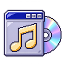
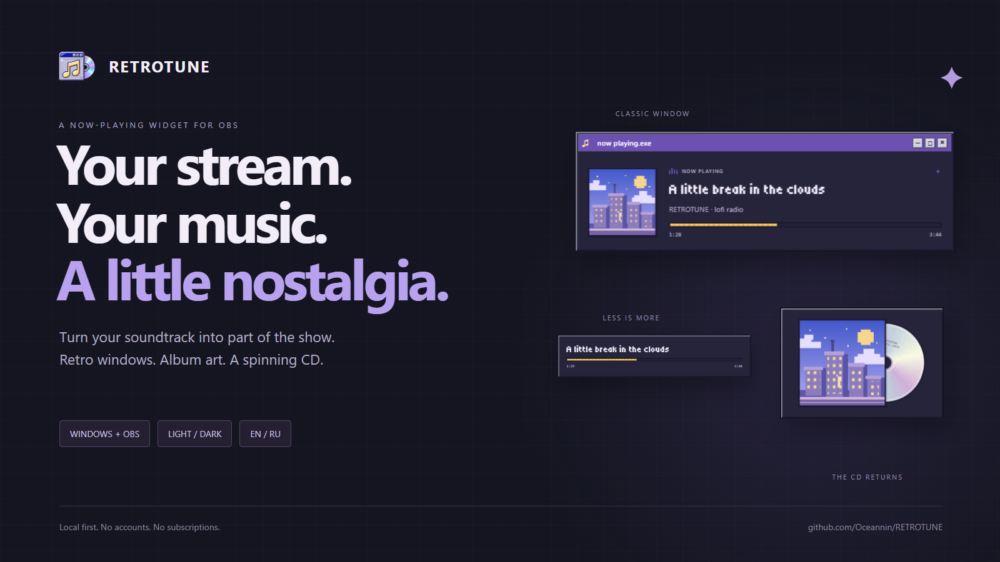
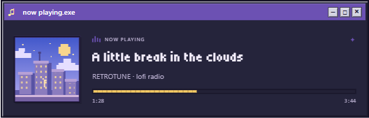
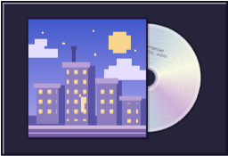
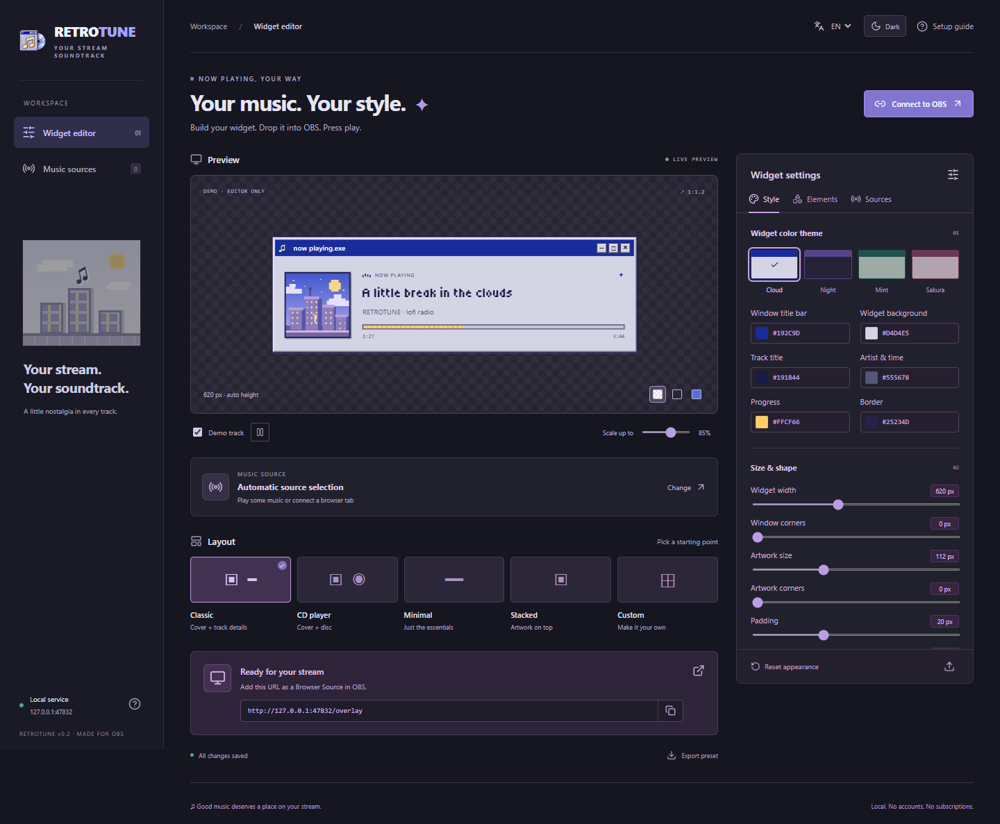
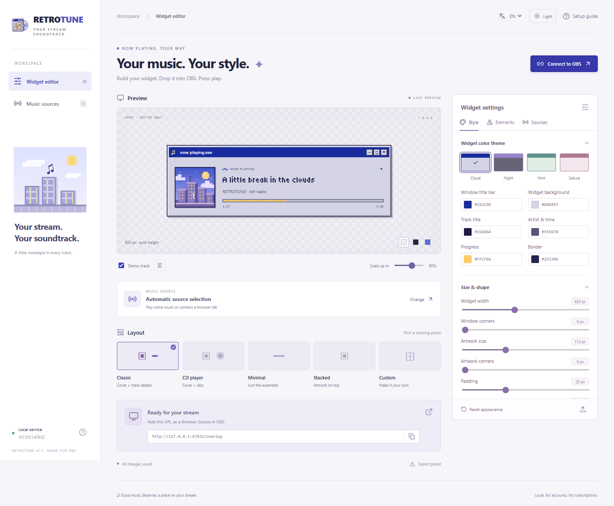
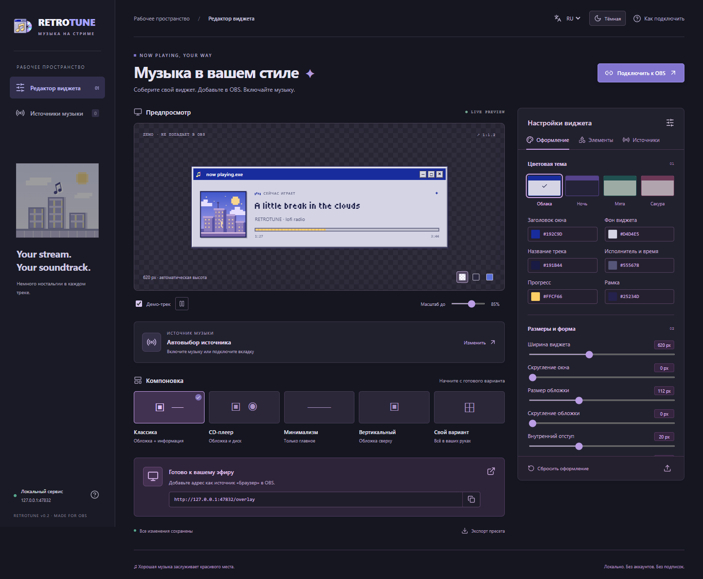

<p align="center"></p>
<h1 align="center">RETROTUNE</h1>
<p align="center"><b>Your stream. Your music. A little nostalgia.</b></p>
<p align="center">A customizable, retro-inspired now-playing widget for OBS on Windows.</p>
<p align="center"><a href="https://github.com/Oceannin/RETROTUNE/releases/latest">Download the preview</a> · <a href="#get-it-on-your-stream">Setup</a> · <a href="README.ru.md">Русский</a> · <a href="docs/CASE-STUDY.md">Behind the design</a></p>
<p align="center">   <a href="LICENSE"></a></p>



Your soundtrack is part of your stream's personality. Give it a place in the scene: a classic desktop window, a tiny title and progress bar, or an album sleeve with a spinning CD peeking out.

**Pick your music source, shape the widget, copy one URL into OBS.** Adjust it live from your browser or an OBS dock. RETROTUNE runs locally, with no RETROTUNE account or subscription.

## Built for your scene

| What you want | What RETROTUNE gives you |
| --- | --- |
| A cozy desktop / retro gaming stream | Beveled windows, a cobalt title bar, pixel typography and four widget palettes |
| A minimal music label | Title + progress, with artwork and extra elements switched off |
| A little motion | A spinning CD that stops on pause; long titles scroll only when they need to |
| Your own visual identity | Independent colors, corners, opacity, spacing, artwork size and title size |
| The right player on screen | Automatic Windows session selection, a pinned source, or one specific browser tab |
| A comfortable editor at night | Full dark and light editor themes, independent of the on-stream widget |
| English or Russian | Saved EN/RU selection for the editor and overlay; localized extension and Lua helper |

### One soundtrack. Different moods.

| Classic window | Album + CD |
| :---: | :---: |
|  |  |

Five starting layouts: **Classic · CD player · Minimal · Stacked · Custom**. Turn artwork, title, artist, status, progress, timestamps, disc and title bar on or off. Swap the artwork and information blocks. Save a look as a JSON preset and reuse it.

### Dark editor. Light editor. Your choice.



<details><summary>See the light editor and Russian interface</summary>




</details>

Screenshots use the editor's **demo track**, not a connected music account. Demo metadata never goes to your OBS overlay.

## Get it on your stream

**This is a Windows preview source bundle, not a standalone installer.** You need [Python 3.12 x64](https://www.python.org/downloads/windows/), [Node.js 22 LTS](https://nodejs.org/) and OBS Studio with Browser Source. Python 3.12 is the verified runtime; Node is needed for setup/build, not for each launch.

1. Download **`retrotune-v0.2.0.zip`** from [Releases](https://github.com/Oceannin/RETROTUNE/releases/latest) and extract it to a permanent folder.
2. Run **`Setup RETROTUNE.cmd`** once. Then run **`Start RETROTUNE.cmd`** to open the editor. Use `Create-Desktop-Shortcut.ps1` if you want a desktop shortcut with the custom icon.
3. Play some music, open **Sources**, and pick a session. Or connect a browser tab using the included extension.
4. In OBS, add a **Browser Source**: URL **`http://127.0.0.1:47832/overlay`**, width **1280**, height **720**. The unused area is transparent; set the widget's actual size in the editor and crop/position the source in OBS.
5. Add your audio to OBS separately. RETROTUNE displays the music information; it does not capture or play your soundtrack.

**Optional OBS dock:** Docks → Custom Browser Docks → `http://127.0.0.1:47832`.

**Optional Lua helper:** Tools → Scripts → add `obs/retrotune.lua`. It starts the local service and can add/reuse the widget in the current scene. Keep it inside the project folder structure. Select EN/RU in the script's properties; reopen its properties if the labels have not refreshed.

Keep the local service running while you use the overlay. Closing the editor tab does not stop it. **`Stop RETROTUNE.cmd`** stops the background service. No Windows startup task is installed.

## Where does the music information come from?

| Source | Connection | What to expect |
| --- | --- | --- |
| A Windows player or browser | Windows media sessions, no extension required | Metadata exposed by that app: title, artist, artwork, duration, position and playback state |
| One exact Chrome / Edge / Brave tab | Included unpacked extension + local pairing key | MediaSession metadata and accessible HTML audio/video timing from the selected page |
| A custom player | Local JSON API | Your adapter posts the fields the player provides |

**For one browser tab:** open your browser's extensions page → Developer mode → Load unpacked → `browser-extension`. In RETROTUNE → Sources, copy the pairing key. Open the music tab, click the extension, paste the key and choose **Connect this tab**. Then pin that tab in the editor. Reconnect after reloading/navigating the page.

The extension uses `activeTab`, scripting, storage and access to the loopback service. It does **not** request permanent access to every website. It only forwards tabs you connect.

### A few honest limits

- An audio signal alone does not contain reliable song titles or artwork. A player must expose metadata, or have an adapter. This is not automatic song recognition.
- Exact-tab capture supports accessible HTML audio/video and MediaSession. Embedded iframe players, closed Shadow DOM, protected players and WebAudio-only apps may expose fewer fields or no timing. Firefox is not supported in this preview.
- Multiple Windows sessions from the same app can be reordered by Windows. Use the extension when one particular tab must stay pinned.
- Missing artwork gets a fallback. Unknown duration stays unknown. If a pinned source disappears, another app's song is **not** substituted. External sources expire after 12 seconds without an update.
- RETROTUNE has no cloud backend. Metadata and settings stay local; album artwork can still be fetched from the music provider's HTTPS image host. Do not expose the local service to the Internet.

See the [verification record](VERIFICATION.md) for what has actually been tested, including remaining gaps.

## Behind the build

The goal was to bring the feeling of a classic desktop music player into a stream overlay, while keeping source selection and visual customization usable. The editor and OBS share the same renderer so the preview matches the on-stream design.

[Read the design case study →](docs/CASE-STUDY.md)

<details><summary>For developers: run, test and connect a player</summary>

```powershell
python -m venv .venv
.\.venv\Scripts\python.exe -m pip install -r requirements.txt
npm ci
npm run build
powershell -NoProfile -ExecutionPolicy Bypass -File .\Start-RETROTUNE.ps1
```

For frontend development, run the local service and `npm run dev`; Vite proxies `/api` to it.

```powershell
npm run build
.\.venv\Scripts\python.exe -m unittest discover -s tests -v
```

**Stack:** React + TypeScript + Vite; Python + aiohttp + PyWinRT; a Chromium MV3 extension; an optional OBS Lua helper. Settings are stored locally in `data/settings.json`. Old presets default to Russian and remain compatible; editor theme is stored separately in browser localStorage.

**Player adapters:** [Local API reference](docs/API.md). **Browser checks and screenshot capture:** [Development guide](docs/DEVELOPMENT.md).

</details>

## Feedback from your next stream

If a player does not show up, [open an issue](https://github.com/Oceannin/RETROTUNE/issues/new/choose) with its name, Windows/OBS/browser versions, and which fields are missing. Please keep pairing keys and personal data out of screenshots and logs.

Code and original assets: [MIT](LICENSE). Tiny5 is bundled under the [SIL Open Font License](public/assets/FONT-LICENSE.txt). The app icon was created with ImageGen; [design notes](docs/icon-design.md).
