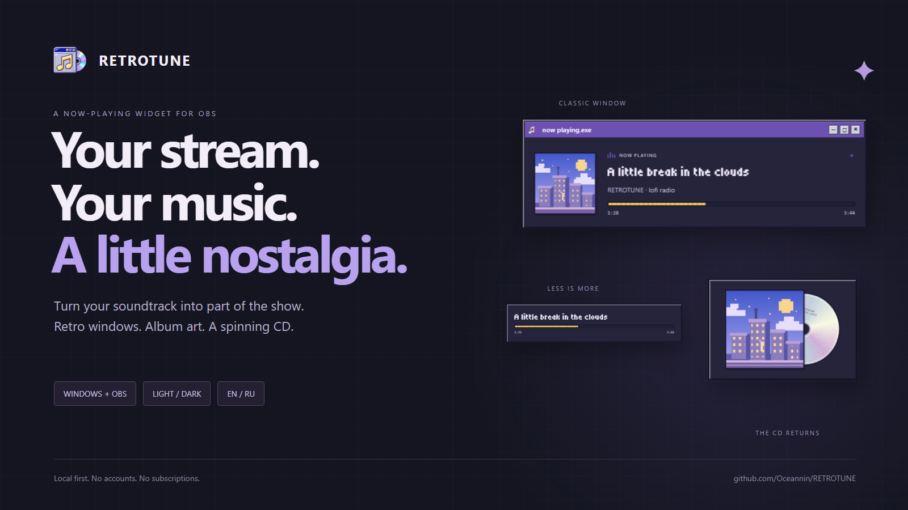
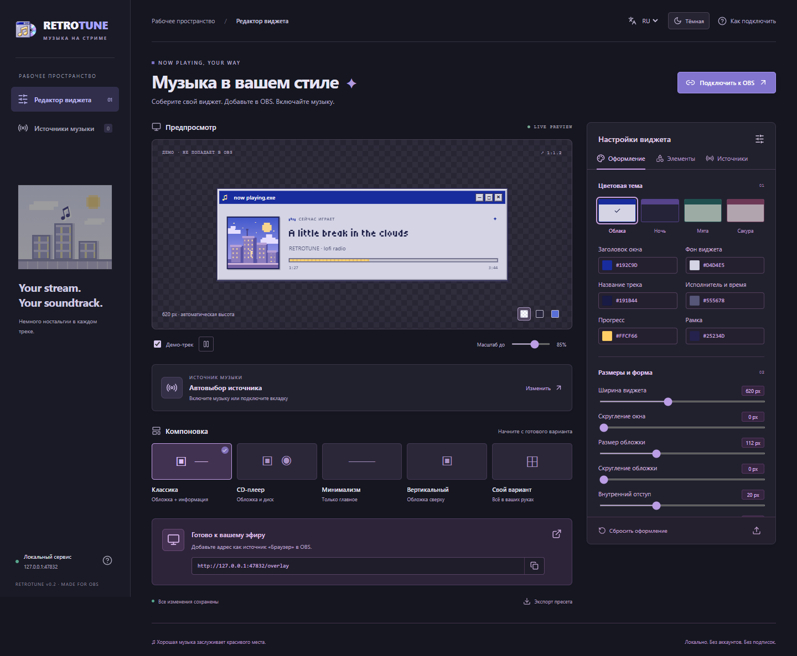

<h1 align="center">RETROTUNE</h1>

<b>Твой стрим. Твоя музыка. Немного ностальгии.</b>

Музыкальный виджет для OBS в стиле классического рабочего стола.

<a href="https://github.com/Oceannin/RETROTUNE/releases/latest">Скачать превью</a> · <a href="README.md">English</a> · <a href="docs/CASE-STUDY.md">Кейс проекта</a>

Музыка — часть атмосферы стрима. RETROTUNE помогает вписать её в сцену: показать обложку и название в ретроокне, оставить только строку с прогрессом или вывести альбом с вращающимся CD.

**Выбери источник → настрой внешний вид → вставь URL в OBS.** Редактор работает в браузере или док-панели OBS. Аккаунт RETROTUNE и подписка не нужны.

## Подстрой под свой эфир

- **Пять компоновок:** классика, CD-плеер, минимализм, вертикальная и пользовательская.
- **Нужные элементы:** обложка, диск, название, исполнитель, статус, прогресс, время и заголовок окна включаются отдельно.
- **Свой стиль:** цвета, скругления, прозрачность, отступы, размеры и порядок двух блоков. Оформление можно сохранить в JSON-пресет.
- **Движение по делу:** длинные названия прокручиваются, CD останавливается на паузе.
- **Тёмный и светлый редактор:** его тема не меняет оформление виджета в эфире. Для самого виджета есть четыре палитры, включая ночную.
- **Русский и английский:** язык редактора сохраняется и применяется к подписям оверлея. Расширение использует язык сервиса; у Lua-помощника свой переключатель EN/RU.
- **Выбор музыки:** медиасессии Windows, закреплённое приложение, конкретная вкладка Chrome/Edge/Brave или адаптер к локальному API.

Скриншоты сняты с демотреком. Демо показывается только в редакторе и не попадает в OBS.

## Как добавить в OBS

Это **предварительная версия для Windows в виде исходников и собранного интерфейса**, а не автономный EXE-установщик. Нужны Python 3.12 x64, Node.js 22 LTS и OBS Studio с источником «Браузер». Node нужен для первоначальной сборки.

1. Скачай `retrotune-v0.2.0.zip` из [Releases](https://github.com/Oceannin/RETROTUNE/releases/latest), распакуй в постоянную папку.
2. Запусти `Setup RETROTUNE.cmd`, затем `Start RETROTUNE.cmd`.
3. Включи музыку и выбери источник во вкладке «Источники». Для точной вкладки используй расширение из папки `browser-extension`.
4. Добавь в OBS «Браузер»: `http://127.0.0.1:47832/overlay`, размер **1280 × 720**. Свободная область прозрачна. Размер виджета меняется в редакторе.
5. Звук добавь в OBS отдельно: RETROTUNE показывает информацию о музыке и не захватывает аудио.

Редактор в OBS: «Док-панели → Пользовательские док-панели браузера», адрес `http://127.0.0.1:47832`.

Опционально добавь `obs/retrotune.lua` через «Сервис → Скрипты». Помощник запускает сервис и добавляет/переиспользует источник в текущей сцене. Не выноси Lua-файл отдельно из проекта. Ярлык рабочего стола создаёт `Create-Desktop-Shortcut.ps1`.

Для вкладки: страница расширений браузера → режим разработчика → «Загрузить распакованное» → `browser-extension`. В редакторе скопируй ключ подключения, открой расширение на странице с музыкой и нажми «Подключить эту вкладку». После обновления страницы подключи её заново.

## Что важно знать

Приложение должно отдавать метаданные. По одному аудиосигналу нельзя достоверно получить название и обложку; распознавание музыки не реализовано. У плееров в iframe, защищённых страниц и WebAudio могут быть ограничения. Firefox пока не поддерживается.

Нет обложки — будет заглушка. Нет длительности — она не придумывается. Если закреплённый источник исчез, чужой трек автоматически не подставится. Для нескольких сессий одного приложения Windows точнее закреплять вкладку расширением.

Сервис работает локально; обложки могут загружаться с HTTPS-сервера музыкального сервиса. Не публикуй локальный порт в Интернет. Для остановки используй `Stop RETROTUNE.cmd`; закрытие вкладки редактора не завершает сервис.

[Подробная инструкция](docs/SETUP.ru.md) · [API адаптеров](docs/API.md) · [Что проверено](VERIFICATION.md) · [Сообщить о проблеме](https://github.com/Oceannin/RETROTUNE/issues/new/choose)

Лицензия кода и оригинальных материалов — [MIT](LICENSE). Шрифт Tiny5 — [SIL OFL](public/assets/FONT-LICENSE.txt).
