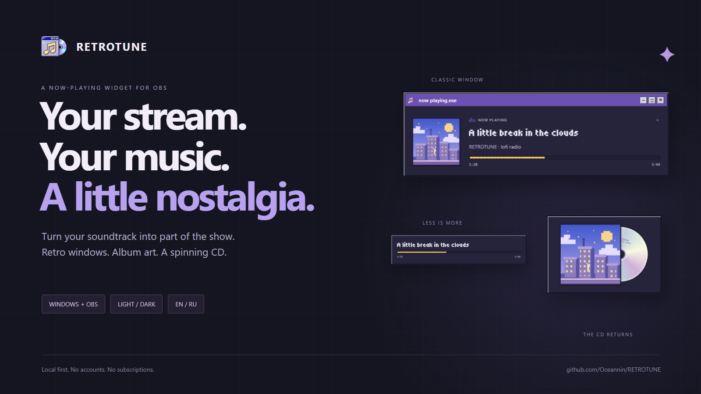
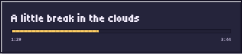
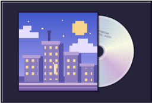
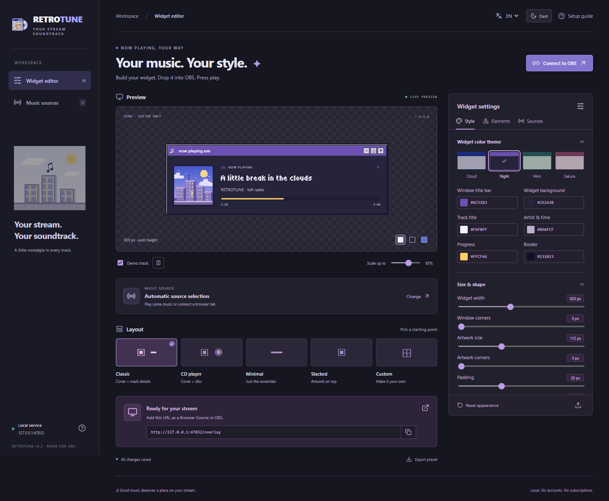

# RETROTUNE — making the soundtrack part of the scene

**Product:** a local now-playing widget for Windows + OBS. **Release:** 0.2.0 preview. **Audience:** streamers who want their music display to match the rest of their scene.

## The brief

Build a music display inspired by a Windows 95 / pixel-art streaming reference. It should follow different music sources and support different scenes: album art on the left, a CD-only view, or a compact title and progress bar. Long track names, missing artwork and pauses needed deliberate behavior.

## The design idea

The widget borrows the grammar of a familiar desktop music player: a cobalt title bar, a silver-lavender beveled frame, restrained pixel typography, and an iridescent CD. The editor uses a quieter interface so the controls remain easy to scan.

The large musical note, miniature window and disc also form the desktop icon. There is no lettering in the icon: it must work at taskbar and desktop sizes, not just in a large mockup. The [icon notes](icon-design.md) document its ImageGen origin and output sizes.

## The workflow

1. **Choose what is playing.** Follow a Windows media session, pin a source, or connect one browser tab with the extension.
2. **Find a starting shape.** Classic, CD player, Minimal, Stacked or Custom.
3. **Make it belong to the scene.** Change colors, corners, spacing, scale and visible elements. Swap the artwork and information blocks.
4. **Put it on stream.** Copy the local overlay URL into an OBS Browser Source. The same renderer drives the editor preview and overlay.

| A compact music label | An album sleeve with motion |
| :---: | :---: |
|  |  |

## The less glamorous states matter

- A long title scrolls only when it overflows. Reduced-motion preferences disable animation.
- The disc stops on pause. Streamers can hide the entire widget while paused.
- Missing artwork gets a fallback; a missing duration does not become a fake timeline.
- Pinning means pinning: losing a source does not unexpectedly put another application's song on screen.
- Demo mode stays inside the editor. It helps design the widget without sending sample metadata to OBS.
- The preview fits narrow windows automatically; the editor remains usable in an OBS dock.

## Light and dark serve different jobs

The **editor theme** is a local viewing preference. The **widget palette** is part of the broadcast design. Keeping them separate lets a streamer work in a dark editor while keeping a light retro widget in the scene.

## Localization is a product feature

English and Russian cover the editor controls, help, notifications, empty states, on-stream status labels and accessibility labels. The language is saved with settings and follows the overlay. The extension reads the service language; the optional OBS Lua helper has its own EN/RU property. Track titles and artists remain exactly as supplied by the music source.

## The engineering behind it

React and TypeScript provide the shared widget and live editor. A Python/aiohttp bridge reads Windows GlobalSystemMediaTransportControls sessions and serves the application over loopback. A Manifest V3 extension forwards MediaSession metadata and accessible HTML audio/video timing from connected tabs. A token-protected local JSON API lets other players provide their own metadata.

The service binds to `127.0.0.1`; settings and the pairing key are local. Incoming settings and track payloads are validated, writes are persisted atomically, external sources expire after 12 seconds, and explicit source selection never falls back to another application.

## What ships, and what does not

This is a working Windows preview distributed as source plus the built UI. Setup currently requires Python and Node, and the integration uses OBS Browser Source plus an optional Lua helper. It is not a native OBS DLL or a standalone desktop installer.

Core browser behavior, EN/RU switching, dark-mode persistence, narrow layouts, the extension's metadata path and native OBS transparency have been exercised. The [verification record](../VERIFICATION.md) keeps specific results and remaining gaps visible. There are no invented adoption, engagement or retention numbers.

Potential next steps are a standalone Windows distribution, broader real-player compatibility testing, and richer block positioning. They are directions, not shipped promises.

## Try it in your scene

[Download the preview](https://github.com/Oceannin/RETROTUNE/releases/latest) · [Setup guide](../README.md#get-it-on-your-stream) · [Report a player compatibility issue](https://github.com/Oceannin/RETROTUNE/issues/new/choose)
