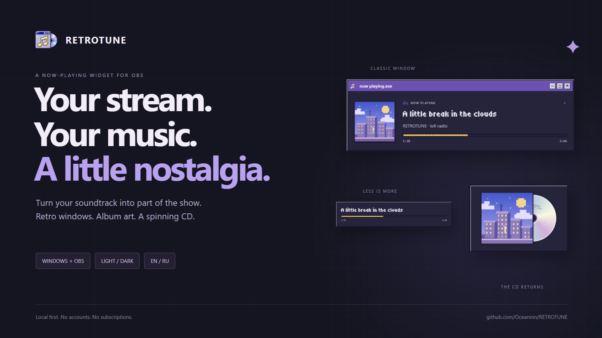

# RETROTUNE 0.2.0 — after dark, in your language

A retro now-playing widget for your OBS scene: album art, scrolling titles, a progress bar and a CD that spins with your soundtrack.

## New in this preview

- A complete dark editor alongside the light version. Editor theme stays separate from your on-stream palette.
- Saved English/Russian localization across the editor and overlay; a localized extension and optional Lua helper.
- A custom extension icon, clearer setup guides and a visual design case study.

## Download & setup

Choose **`retrotune-v0.2.0.zip`** below. It includes the source and built interface. **This is not a standalone EXE installer.** Windows, Python 3.12 x64, Node.js 22 LTS and OBS Browser Source are required.

Extract to a permanent folder → run `Setup RETROTUNE.cmd` → run `Start RETROTUNE.cmd` → choose your music source → add `http://127.0.0.1:47832/overlay` as an OBS Browser Source (1280×720).

Audio must be added to OBS separately. Apps must provide metadata; the extension supports accessible HTML audio/video and MediaSession, with limits for iframe/protected/WebAudio-only players. [Full setup and compatibility notes](https://github.com/Oceannin/RETROTUNE#readme).

## Updating from 0.1

Keep `data/settings.json` and `data/token.txt`. Existing presets still load and default to Russian. Reload the unpacked extension after replacing its files. Create the desktop shortcut again if the project folder moved.

## Validation

Windows production build and eight backend tests passed locally. EN/RU switching, dark preference persistence, help text and responsive layouts were exercised in a browser. Exact-tab metadata and native OBS rendering have dedicated smoke checks; the [verification record](https://github.com/Oceannin/RETROTUNE/blob/main/VERIFICATION.md) documents the remaining gaps.

Preview release: player compatibility and standalone packaging are still evolving.
